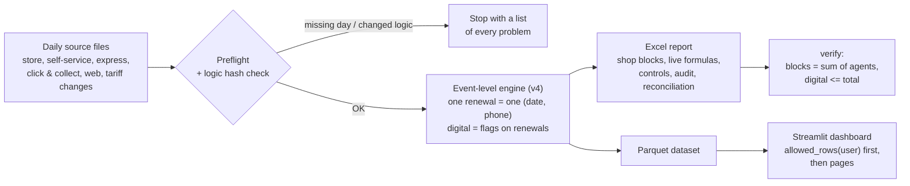
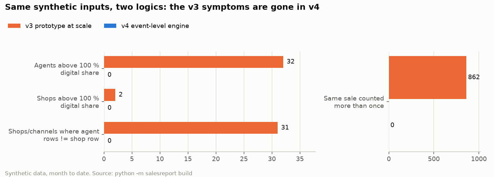
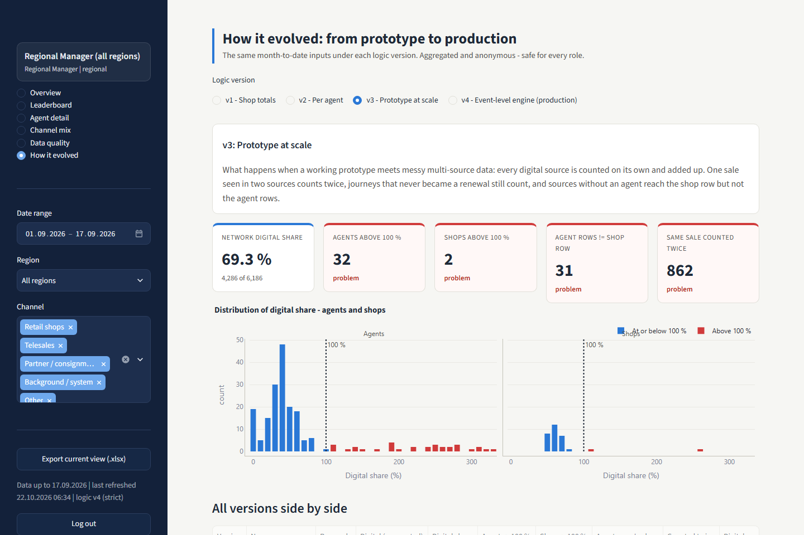
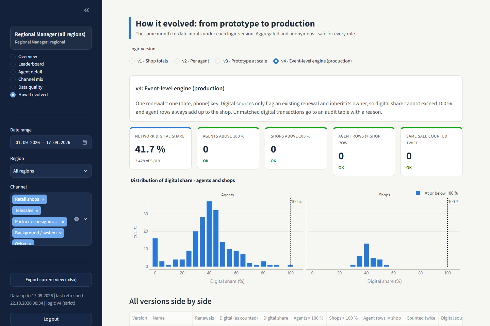
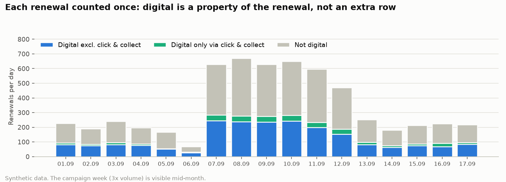
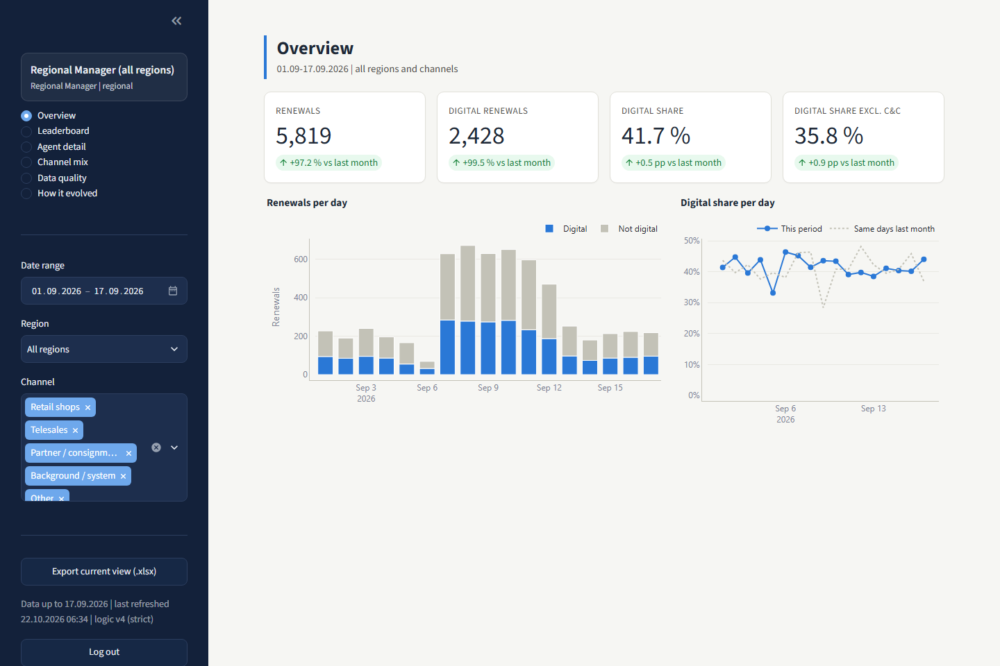
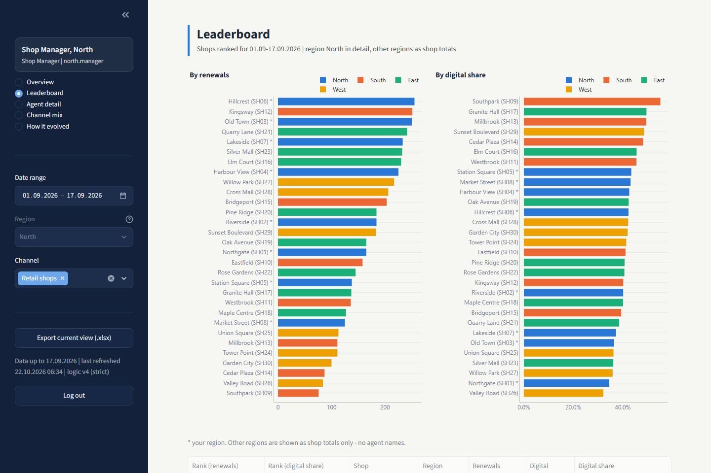
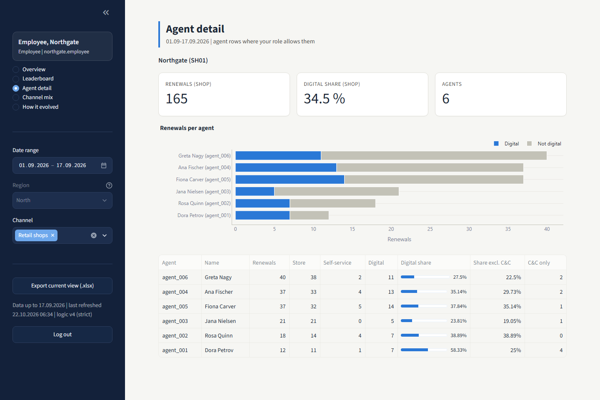

# Renewals reporting engine and role-based dashboard

[](https://github.com/GerasimoskiDesign/streamlit-dashboard/actions/workflows/ci.yml)

An event-level engine that counts contract renewals and their digital share so that digital share can never exceed 100 % and agent rows always add up to their shop, plus a Streamlit dashboard where every role sees exactly its own numbers.

Rebuilt from scratch on synthetic data. The production version is proprietary.

## The problem

A retail network's sales team is measured on contract renewals and on how many of them go through digital channels ("digital share"). The numbers came from six daily exports in different formats and lived in Excel files only the reporting team could open. As more digital channels were added, the simple counts started producing results nobody could defend: shops above 100 % digital share, agent rows that did not add up to the shop, and the same sale counted twice. The report needed to become a single, verifiable source of truth that each level of the network can see for itself.

## What this does

Six daily source files go through a hash-locked, event-level engine. The engine writes a formula-driven Excel report (checked by a built-in verifier) and a Parquet dataset; the dashboard reads only the Parquet and filters it by role before any page sees it.



**The engine** (`python -m salesreport build 17.09.2026`) implements ten counting rules, documented with the reason behind each in [docs/COUNTING_RULES.md](docs/COUNTING_RULES.md). In short: one `(date, phone)` key is one renewal; only qualifying store or self-service contracts create renewals; express journeys, click & collect and web orders only *flag* an existing renewal and inherit its owner; every digital transaction that matches no renewal goes to an audit sheet with a reason; web orders may link to a renewal booked up to three days later; the month is always recomputed from day 1.

**Production hardening** (all implemented and tested):

| Safeguard | What it does |
|---|---|
| Locked logic | `LOCKED_LOGIC.sha256` lists the engine files. `build` verifies the hashes first and refuses to run if a file changed ("logic was modified - re-validate before publishing numbers"). `python -m salesreport lock` re-locks after a reviewed change. |
| Preflight | Before anything is computed, every day folder from day 1 to the chosen day is checked for all six sources; all missing days/files are listed at once and the build stops. |
| Robust inputs | Header row and sheet found by matching required column names (title rows, "Info" sheets); Unicode NFKC + case-folding for text; phones reduced to digits after stripping Excel's `.0`; reading stops after a run of blank rows; file names tolerate non-padded dates and Cyrillic look-alike letters; an override table resolves days with a partial re-export. |
| Forgiving date input | `17.09.2026`, `17.09`, `17` or a pasted range `01.09.2026-17.09.2026` (end date taken). Interactive prompt when no date is given in a terminal. |
| Built-in verification | `python -m salesreport verify` re-reads the workbook, evaluates its formulas and checks: every shop block = sum of its agent rows, no row with digital > total, grand total = sum of blocks. Prints OK or the exact failing rows. |
| Control totals | A sheet with totals (all channels vs shops only), events and collapsed rows per source, unmatched digital by reason, look-ahead links, invariants that must be 0, agents without a display name. |
| Reconciliation | A sheet comparing per-agent totals with an independent manual count for one week. The logic was validated against an independent manual count before it was locked. |

**The dashboard** (`python -m salesreport dashboard`) has six pages: Overview (KPI tiles with change vs the same days last month, daily trend), Leaderboard, Agent detail, Channel mix, Data quality, and How it evolved. Sidebar filters for date range (month to date by default), region (where allowed) and channel; Excel export of the current filtered view; a "data last refreshed" stamp; and a maintenance flag (`SALESREPORT_MAINTENANCE=1`) that shows "Refreshing data, check back in a few minutes" while the daily recompute runs.

Permissions are enforced in one data-access function, `allowed_rows(user, frame, dataset)` in [`dashboard/access.py`](src/salesreport/dashboard/access.py), never by hiding UI. The Excel export receives the same filtered rows, so it cannot leak anything a page would not show. Every cell of this matrix is covered by a test:

| Resource | Regional Manager | Shop Manager | Employee |
|---|:---:|:---:|:---:|
| Own shop - shop totals | yes | yes | yes |
| Own shop - agent detail | yes | yes | yes |
| Other shops in own region - shop totals | yes | yes | no |
| Other shops in own region - agent detail | yes | yes | no |
| Other regions - shop totals (leaderboard) | yes | yes | no |
| Other regions - agent detail | yes | no | no |
| Other channels (telesales, partner, system, other) | yes | no | no |
| Data quality (controls, unmatched audit) | yes | no | no |
| How it evolved (aggregated, anonymous) | yes | yes | yes |

A Shop Manager is locked to one region; other regions appear on the leaderboard as shop totals with no agent names.

**Demo users** (bcrypt-hashed in [`config/users.toml`](config/users.toml); passwords are demo values only - production would use the company single sign-on):

| Username | Password | Role | Scope |
|---|---|---|---|
| `regional` | `demo-regional` | Regional Manager | everything |
| `north.manager` | `demo-north` | Shop Manager | region North |
| `east.manager` | `demo-east` | Shop Manager | region East |
| `northgate.employee` | `demo-northgate` | Employee | shop Northgate (SH01, North) |
| `unionsquare.employee` | `demo-unionsquare` | Employee | shop Union Square (SH25, West) |

## Results on synthetic data

All numbers below are produced by running this repo (`generate`, then `build 17.09.2026`) on the seeded synthetic data: 30 shops in 4 regions, 200 agents, 92 days, about 19,500 renewals. They are synthetic and say nothing about any real business.

### How it evolved: from prototype to production

The same month-to-date inputs (01.09-17.09.2026) under each logic version. All four versions are in the repo and selectable on the dashboard's "How it evolved" page.

| Version | Idea | Renewals | Digital | Digital share | Agents > 100 % | Shops > 100 % | Agent rows != shop row | Same sale counted more than once |
|---|---|---:|---:|---:|---:|---:|---:|---:|
| v1 Shop totals | contract rows per shop, self-service = digital | 6,186 | 978 | 15.8 % | n/a | 0 | n/a | 367 |
| v2 Per agent | rows per agent, agent -> home shop | 6,186 | 978 | 15.8 % | 0 | 0 | 0 | 367 |
| v3 Prototype at scale | every digital source counted separately and added | 6,186 | 4,286 | 69.3 % | **32** | **2** | **31** | **862** |
| v4 Event-level engine | one renewal per key, digital sources as flags | 5,819 | 2,428 | 41.7 % | 0 | 0 | 0 | 0 |

1. **v1 - shop totals.** Count renewal and self-service contracts per shop for the month to date. Fast and useful, but no agent view, one digital source, and duplicate export rows count twice.
2. **v2 - per agent.** Attribute each contract to its agent and each agent to a home shop. Shop managers can now see who sells what. Agents working in two shops are booked to their home shop only, and digital still means self-service only.
3. **v3 - the prototype at scale.** To cover express journeys, click & collect and web orders, each digital source is counted on its own and the counts are added up, per agent by that source's agent field and per shop by that source's shop field. This is what happens when a working prototype meets messy multi-source data: a renewal seen in two sources counts twice, journeys that never became a renewal still count, sources without an agent reach the shop row but not the agent rows, and some agents and shops end up above 100 %. The version stays in the repo on purpose, and a regression test asserts that it shows these symptoms on the campaign week.
4. **v4 - the event-level engine.** One renewal per `(date, phone)`, digital sources as flags with the contract's owner, audit instead of silent drops. Every invariant holds by construction, and the build checks them again on the finished workbook.



| v3 on the dashboard | v4 on the dashboard |
|---|---|
|  |  |

### Control totals (v4, 01.09-17.09.2026, strict variant)

| Check | Value |
|---|---:|
| Renewals, all channels / shops only / other channels | 5,819 / 5,072 / 747 |
| Digital renewals, all channels / shops only | 2,428 / 2,089 |
| Duplicate rows collapsed (store / express / click & collect) | 197 / 75 / 8 |
| Unmatched digital transactions (a excluded population / b not a renewal / c no contract) | 1,384 (580 / 157 / 647) |
| ... of which web orders with the look-ahead window still open | 31 |
| Web look-ahead links (from orders placed before 01.09) | 162 (14) |
| Web renewals without contract record, excluded in strict | 60 |
| Agents above 100 %, shops above 100 %, blocks with agent rows != shop row, duplicate keys | 0, 0, 0, 0 |
| Agents without a display name | 2 |
| Reconciliation vs independent manual count, 01.09-07.09 | 193 agents match, 2 differ (the two injected manual slips) |

Every renewal is counted once; digital is a property of the renewal, so the daily bars below can never exceed the total:



### One screenshot per role

| Regional Manager - Overview | Shop Manager (North) - Leaderboard | Employee (Northgate) - Agent detail |
|---|---|---|
|  |  |  |

## Production context

The production version replaced a manually built monthly Excel report with a locked, verified event-level engine and a role-based web dashboard; it has been the team's official source for renewal and digital-share numbers since its release.

## Quickstart

Requires Python 3.11+. Companion repo: [retail-renewals-reporting-pipeline](https://github.com/GerasimoskiDesign/retail-renewals-reporting-pipeline) is the downloader that produces the daily source files this engine reads. This repo is standalone and generates its own synthetic files, so nothing else is needed.

**Windows PowerShell**

```powershell
git clone https://github.com/GerasimoskiDesign/streamlit-dashboard.git
cd streamlit-dashboard
python -m venv .venv
.\.venv\Scripts\Activate.ps1
python -m pip install --upgrade pip
pip install -e ".[dev]"

python -m salesreport generate            # synthetic daily files into .\data
python -m salesreport build 17.09.2026    # lock check, preflight, Excel + Parquet into .\output
python -m salesreport verify              # re-check the newest workbook
python -m salesreport dashboard           # http://localhost:8501
pytest -q
```

**macOS / Linux**

```bash
git clone https://github.com/GerasimoskiDesign/streamlit-dashboard.git
cd streamlit-dashboard
python3 -m venv .venv
source .venv/bin/activate
python -m pip install --upgrade pip
pip install -e ".[dev]"

python -m salesreport generate
python -m salesreport build 17.09.2026
python -m salesreport verify
python -m salesreport dashboard
pytest -q
```

Other useful commands:

```text
python -m salesreport build                      # prompts for the date (17.09.2026, 17.09, 17 or a range)
python -m salesreport build 17 --variant full    # rule 10: count web renewals without a contract record
python -m salesreport preflight 17.09.2026       # only check that all inputs exist
python -m salesreport lock --check               # verify the logic lock without building
python -m salesreport lock                       # re-lock after a reviewed change to the engine
python -m salesreport charts                     # re-render the README charts from output/
python scripts/take_screenshots.py               # README screenshots (pip install -e ".[screenshots]"
                                                 #   and python -m playwright install chromium first)
```

Settings come from environment variables or a local `.env` (see [.env.example](.env.example)): data and output folders, the users file, and the maintenance flag.

### Deploy to Streamlit Community Cloud

Point a new Community Cloud app at this repo with `streamlit_app.py` as the entry file. `requirements.txt` installs the package; on first start the wrapper runs the generator and the engine once into a temp folder, then serves the normal dashboard (the dashboard still only reads Parquet).

Live demo: coming soon.

## Project structure

```text
streamlit-dashboard/
├── src/salesreport/
│   ├── cli.py                  # python -m salesreport <command>
│   ├── rules.py                # business constants (locked)
│   ├── normalize.py            # text / code / phone normalisation (locked)
│   ├── dates.py                # forgiving date input
│   ├── lock.py                 # LOCKED_LOGIC.sha256 handling
│   ├── settings.py             # env-driven paths and flags
│   ├── inputs/                 # excel_reader (header detection), files (name resolution,
│   │                           # overrides), preflight, loader (locked)
│   ├── engine/                 # v1, v2, v3, v4 (locked), common + model (locked), compare
│   ├── report/                 # build pipeline, excel, formula evaluator, verify,
│   │                           # controls + reconciliation, dataset (Parquet), charts
│   ├── generator/              # seeded master data, day simulation, messy XLSX writer
│   └── dashboard/              # app, access (permissions), auth (bcrypt), views, export
├── tests/                      # pytest: rules, look-ahead, inputs, hardening, synthetic, access
├── config/users.toml           # demo users (bcrypt hashes)
├── config/overrides.csv        # per-day file override table
├── data/GENERATOR.md           # everything the generator injects
├── docs/COUNTING_RULES.md      # the ten rules and why each exists
├── docs/img/                   # charts and screenshots used here
├── scripts/take_screenshots.py # Playwright: one screenshot per role
├── streamlit_app.py            # hosted-demo entry point
├── LOCKED_LOGIC.sha256         # hashes of the engine files
└── .streamlit/config.toml      # dashboard theme
```

## Design decisions & trade-offs

- **Events, not counts.** Every number is a sum over one table of renewals with boolean flags. That is what makes "digital <= total" and "agents sum to shop" identities instead of hopes. The cost is that a source without a phone number or date cannot be used at all; such rows are dropped with a logged warning.
- **Shop rows are computed independently, not as `SUM` of agent rows.** The workbook could make the shop row a formula over its agents, but then `verify` would only check a formula against itself. Writing the engine's own per-shop aggregation and verifying it against the agent rows catches real disagreements and hand edits. Totals and shares are still live formulas.
- **`verify` evaluates formulas itself.** openpyxl cannot calculate, and a freshly written workbook has no cached values. A small evaluator covers the formula subset the report writes (`SUM`, `IF`, arithmetic, comparisons) and refuses anything else rather than guessing.
- **Hash lock normalises line endings.** The same commit checked out on Windows (CRLF) and Linux (LF) must give the same hashes, otherwise the lock would fail for the wrong reason. `.gitattributes` also forces LF.
- **Strict variant by default.** Web renewals without any contract record cannot be attributed to a shop or verified, so the official number excludes them and the Control totals sheet shows how many there are. `--variant full` exists for when the business wants the customer view.
- **A "Web order" column next to the specified flag columns.** Rule 7 makes web orders a fourth digital flag, so the report shows it. A "Web w/o contract" column exists for the full variant and is hidden in strict, so the column layout (and `verify`) is the same in both variants.
- **Employees see their colleagues in their own shop.** "Only their own shop" was read as the shop's full detail, as on a shop's own leaderboard. Tightening this to "only my own row" would be a one-line change in `allowed_rows` plus the matrix.
- **The dashboard never recomputes business logic.** It sums engine-computed counts; whether a renewal is digital, C&C-only or excluded is decided once, in the engine. The hosted-demo wrapper calls the engine, not the dashboard, to produce data.
- **Demo auth is deliberately simple.** bcrypt hashes in a TOML file and `st.session_state` are enough to demonstrate role-based access; production would use the company SSO and map groups to the three roles.
- **Synthetic truth as the test oracle.** The generator records what really happened (every renewal, owner and flag, every intended audit reason) and the tests require the engine to reproduce it exactly for a full month. This is stronger than invariant checks alone, but only as good as the generator's model of the mess.
- **Limitations / next steps.** One month is processed in memory (fine for this scale, not for years of history); history months are recomputed on every build instead of being frozen and versioned; the reconciliation is per agent only; the formula evaluator is intentionally tiny; screenshots and charts are regenerated by hand. Next I would add a frozen month-end snapshot with a diff report against the live recompute, per-day reconciliation, and a scheduled build with alerting on preflight failures.

## Tech stack

Python 3.11, pandas, NumPy, openpyxl, PyArrow (Parquet), Streamlit, Plotly, matplotlib (README charts), bcrypt, python-dotenv, pytest (including Streamlit `AppTest`), ruff, Playwright (screenshots), GitHub Actions.
